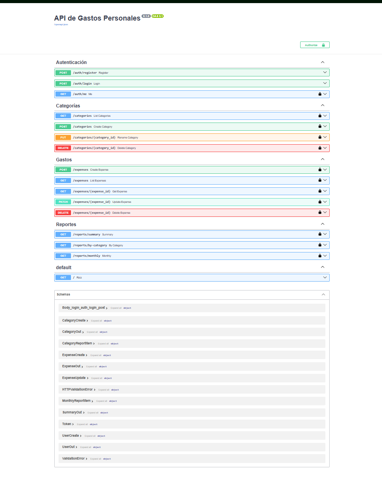
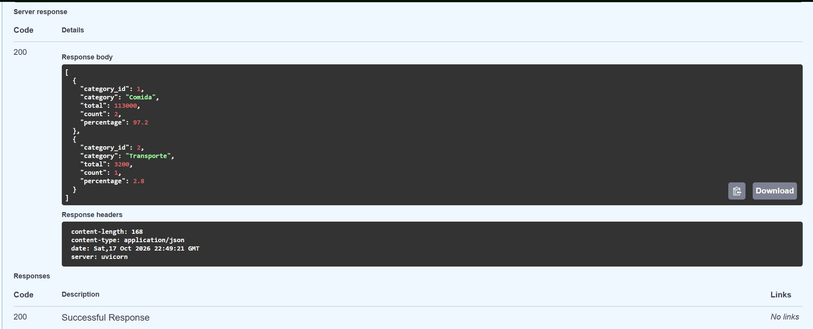
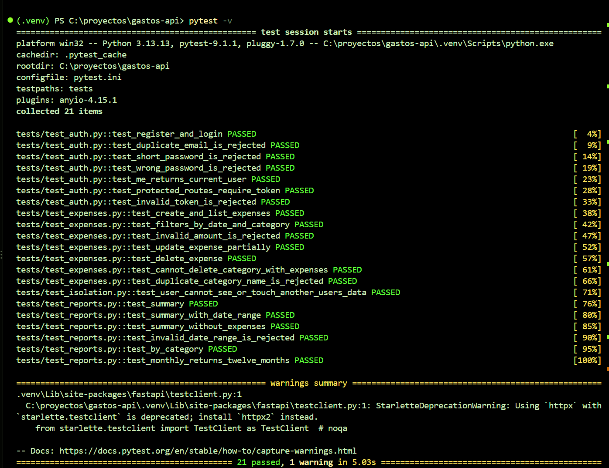

# API de Gastos Personales

API REST para llevar el control de gastos personales: cada usuario registra sus gastos por categoría y consulta reportes (resumen, total por categoría y total por mes). Cada cuenta ve únicamente sus propios datos.

Proyecto personal construido con Python y FastAPI para practicar el diseño de un backend: modelos, autenticación, seguridad, reportes con consultas agregadas y pruebas automáticas.

## Capturas







## Funcionalidades

- Registro e inicio de sesión con tokens JWT; contraseñas guardadas con hash Argon2
- Datos privados por usuario: nadie puede leer, editar ni borrar recursos de otra cuenta
- Categorías: crear, listar, renombrar y borrar (no se borra una categoría con gastos asociados)
- Gastos: crear, listar con filtros (rango de fechas y categoría) y paginación, editar parcialmente y borrar
- Reportes calculados en la base de datos:
  - **Resumen:** total, cantidad, promedio y gasto más grande en un rango de fechas
  - **Por categoría:** total, cantidad y porcentaje de cada categoría
  - **Mensual:** total por mes de un año (siempre devuelve los 12 meses)
- Validaciones: montos mayores a cero, contraseñas de al menos 8 caracteres, rangos de fechas coherentes
- Documentación interactiva generada automáticamente (Swagger en `/docs`)
- 21 pruebas automáticas con pytest

## Tecnologías

- **Lenguaje y framework:** Python, FastAPI
- **Validación:** Pydantic
- **Base de datos y ORM:** SQLite con SQLAlchemy 2 (consultas portables a PostgreSQL)
- **Seguridad:** JWT (PyJWT) y hash de contraseñas con Argon2 (pwdlib)
- **Pruebas:** pytest con base de datos en memoria
- **Control de versiones:** Git y GitHub

## Endpoints principales

| Método | Ruta | Descripción |
|---|---|---|
| POST | `/auth/register` | Crear una cuenta |
| POST | `/auth/login` | Iniciar sesión y obtener el token |
| GET | `/auth/me` | Datos del usuario autenticado |
| POST / GET | `/categories` | Crear y listar categorías |
| PUT / DELETE | `/categories/{id}` | Renombrar y borrar una categoría |
| POST / GET | `/expenses` | Crear gastos y listarlos (filtros `date_from`, `date_to`, `category_id`, `skip`, `limit`) |
| GET / PATCH / DELETE | `/expenses/{id}` | Consultar, editar y borrar un gasto |
| GET | `/reports/summary` | Resumen de un rango de fechas |
| GET | `/reports/by-category` | Gasto por categoría con porcentajes |
| GET | `/reports/monthly` | Total por mes de un año |

Todas las rutas, salvo el registro y el inicio de sesión, requieren el encabezado `Authorization: Bearer <token>`.

## Estructura del proyecto

```
├── app/
│   ├── main.py          # Aplicación y registro de rutas
│   ├── config.py        # Configuración (clave secreta, expiración del token)
│   ├── database.py      # Conexión y sesiones de base de datos
│   ├── models.py        # Modelos de SQLAlchemy
│   ├── schemas.py       # Esquemas de Pydantic (entrada y salida)
│   ├── security.py      # Hash de contraseñas y tokens JWT
│   ├── deps.py          # Dependencias: sesión y usuario actual
│   └── routers/         # auth, categories, expenses, reports
├── tests/               # Pruebas con pytest
├── docs/                # Capturas de pantalla
└── requirements.txt
```

## Cómo ejecutarla en local

Requisitos: Python 3.11 o superior y Git.

```bash
git clone https://github.com/JSV-AFK/gastos-api.git
cd gastos-api
python -m venv .venv
```

Activa el entorno virtual:

```bash
# Windows (PowerShell)
.venv\Scripts\Activate.ps1

# macOS / Linux
source .venv/bin/activate
```

Instala las dependencias y arranca el servidor:

```bash
pip install -r requirements.txt
fastapi dev app/main.py
```

Abre `http://127.0.0.1:8000/docs`, registra un usuario con `POST /auth/register`, pulsa **Authorize** (deja `client_id` y `client_secret` vacíos) y prueba los endpoints.

## Pruebas

```bash
pytest -v
```

Las pruebas usan una base de datos SQLite en memoria, así que no tocan tus datos. Cubren autenticación, gastos, reportes y, en especial, el **aislamiento entre usuarios**.

## Seguridad

- Las contraseñas nunca se guardan en texto plano: se almacenan con hash Argon2.
- Los recursos de otro usuario responden `404`, sin revelar que existen.
- En producción la clave de firma debe definirse con la variable de entorno `SECRET_KEY`. Se puede generar con:

```bash
python -c "import secrets; print(secrets.token_hex(32))"
```

## Lo que aprendí

- Diseñar una API REST con FastAPI, Pydantic y SQLAlchemy
- Implementar autenticación con JWT y proteger datos por usuario
- Escribir consultas agregadas (`SUM`, `COUNT`, `GROUP BY`) en lugar de procesar datos en Python
- Escribir pruebas automáticas, incluida una de seguridad entre usuarios
- Organizar un proyecto en capas y trabajar con Git y GitHub

## Próximos pasos

- Migrar a PostgreSQL y usar `Decimal` para los montos
- Migraciones de base de datos con Alembic
- Contenerización con Docker y despliegue en la nube
- Presupuestos mensuales por categoría

## Autor

**Juan Sebastián Vélez Correa**: estudiante de Ingeniería Informática

GitHub: [JSV-AFK](https://github.com/JSV-AFK)